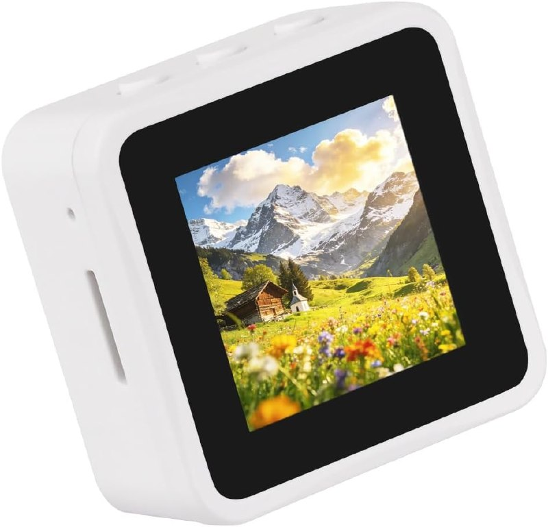

# AlarmClock

A self-built **Internet radio alarm clock** based on the
**Waveshare ESP32-S3-Touch-LCD-1.54** development board, integrated with
**Home Assistant** over **MQTT (with MQTT discovery)**.

Home Assistant will be able to:

- Set / change the alarm time
- Enable / disable the alarm (per day-of-week)
- Select a station and control volume
- Expose the radio as a `media_player` entity (via HA's built-in **Universal
  Media Player** — no custom component)
- Support **multiple clocks**, each appearing as its own Home Assistant device
  (all MQTT topics/entities namespaced by a unique per-device id)

The device itself provides an on-screen clock, touch controls, a local
speaker, and snooze/dismiss buttons, and keeps its **alarm schedule on-device**
so it still rings if Home Assistant or the broker is down.

> 📄 **Docs:** [`design.md`](./design.md) (full design, research, risks,
> roadmap) · [`tasks.md`](./tasks.md) (task breakdown) ·
> [`docs/mqtt-interface.md`](docs/mqtt-interface.md) (firmware↔HA contract) ·
> [`docs/setup.md`](docs/setup.md) (build/install/use).

## Hardware

- **Board:** Waveshare ESP32-S3-Touch-LCD-1.54 (`ESP32-S3-Touch-LCD-1.54-EN`)
  - Touch version, **no LiPo battery**, **includes a custom-molded square
    plastic case** — i.e. it arrives enclosed and bedside-ready.
  - https://github.com/waveshareteam/ESP32-S3-Touch-LCD-1.54
  - https://www.amazon.co.uk/gp/product/B0GS9CW66Z/ref=sw_img_1?smid=&psc=1

### Photos



*The board in its included custom-molded square plastic case.*

## Repository layout

```
firmware/    ESPHome config (alarmclock.yaml) — alarm, radio, MQTT, Wi-Fi onboarding
docs/        mqtt-interface.md (contract), setup.md, devices.md, images/
ha/          Home Assistant snippets (Universal Media Player)
data/        stations.yaml — Internet radio station list
tools/       mqtt_sim.py — device simulator (test the whole HA side without hardware)
.github/     CI — validates + compiles the firmware with no device
```

## Links

- Board source repo (Waveshare): https://github.com/waveshareteam/ESP32-S3-Touch-LCD-1.54
- Purchase (Amazon UK): https://www.amazon.co.uk/gp/product/B0GS9CW66Z/ref=sw_img_1?smid=&psc=1

## Status

🟢 **In progress — Track A (no-hardware work) complete.** The ESPHome firmware
validates and **compiles clean**, the full HA integration (20 MQTT-discovered
entities) is verified against a device **simulator**, and CI is green. Remaining
work needs the physical board (flash, calibrate, on-device validation) — see the
Track B section of [`tasks.md`](./tasks.md).

## License

TBD (Apache-2.0 to match the Waveshare vendor code is a sensible default).
